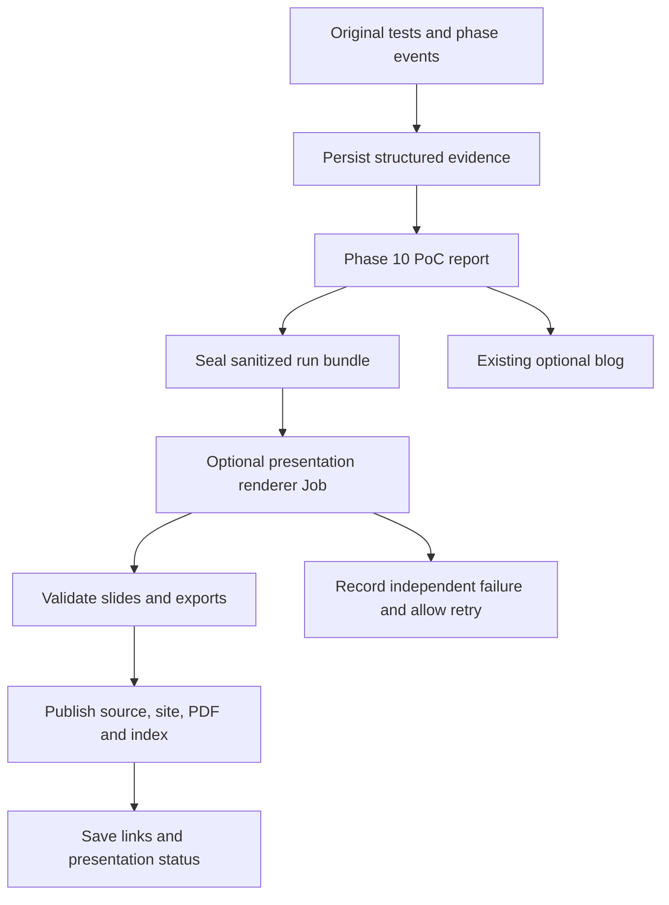

# AutoPoC presentation session handoff and automation plan

Updated: 26 October 2026.

## Executive summary feature scope

The requested AutoPoC feature now includes an automatically generated Slidev
presentation **and a video of that presentation**, both written for executives.
Each must cover repository purpose, testing strategy, how the tests actually
ran, and the report's conclusions about suitability for OpenShift/Kubernetes.
Link the outputs from the report's Executive Summary and a standalone
`executive-summary.md`.

Phase 1 produces a silent video with on-screen text. **Google TTS voice-over
belongs to Phase 2**, as explicitly requested on 26 October. Video recording
is now part of the first feature milestone; it is no longer only a possible
future deliverable. The existing 18-slide Omnigent deck remains the successful
reference, not the default length of an executive summary.

The [executive presentation and video design](superpowers/specs/2026-10-26-executive-summary-design.md)
defines the full feature and its acceptance criteria. Following Astra review,
the cluster design uses a separate renderer Job with its own resource limits,
durable render inputs and recovery checkpoints. The six-slide, roughly
two-minute narrative remains the default recommendation. Drive publishing
requires retry-safe upload IDs; every artifact writer must preserve shared
history. Runtime implementation has not started and remains on hold.

The [evidence collector plan](superpowers/plans/2026-10-26-presentation-evidence.md)
is a prerequisite within this feature, rather than its complete scope.

The active implementation sequence is in sections 6.3–6.7 of
[implementation-plan.md](../.opencode/plans/implementation-plan.md): artifact
preservation, durable recovery, deck/video rendering, cluster isolation and
end-to-end publication. The original roadmap below is historical context;
the revised executive design governs where they differ.

## Completed sample and original roadmap

The Omnigent run now has an editable Slidev presentation, animated TopoLoop
diagrams, a static browser build, a PDF, and a packaged evidence archive.
This proves the presentation approach for one completed run. Collection,
authoring, packaging, and verification were coordinated manually in this
session; automatic presentation generation is not yet part of AutoPoC.

The next implementation step is to preserve a complete, sanitized evidence
bundle during the original run. A separate renderer can then turn that bundle
into a presentation without repeating the PoC or requiring an operator's
desktop. The executive video scope above extends this original roadmap.

Related work: [AIPCC-32887](https://redhat.atlassian.net/browse/AIPCC-32887)
and [AIPCC-33008](https://redhat.atlassian.net/browse/AIPCC-33008).

## What we completed

1. Monitored `job/autopoc-omnigent-8554` in namespace `autopoc-test` with
   `oc logs -f`, and inspected selected job, build, and deployment metadata.
   Monitoring was read-only. Cluster authentication expired during collection;
   the operator renewed the OpenShift login before collection continued.
2. Retrieved generated reports and manifests from a pinned GitHub artifact
   revision. Extracted the five original test results from the runner log;
   tests were not replayed. Archived sanitized runner/build logs, selected
   execution events, provenance, and source hashes.
3. Created a stakeholder/manager presentation with source links and speaker
   notes. The final deck has 14 main slides and four technical appendix slides.
4. Added a setup topology on slide 7 and a five-scenario flow on slide 8 using
   TopoLoop. These reconstruct saved evidence; their animation timing is
   illustrative, not a packet capture or original execution trace.
5. Built the browser site and exported an 18-page PDF with headless Chromium.
   Inspected slide layout, all eight animation acts, reduced-motion and
   still-frame controls, inactive-slide cleanup, and missing-evidence handling.
   Verified the upstream runtime copy and retained its licenses.
6. Packaged source, evidence, static site, and PDF into a ZIP. Presentation
   sources and sanitized evidence are committed; generated build outputs are
   ignored and must be rebuilt when checking out the repository elsewhere.

The main implementation commits are `3298e31` (deck and evidence) and
`be4dbc4` (TopoLoop integration). Work is on branch
`codex/aipcc-33008-slidev-epic`, rather than the default branch.

## Repositories and tools used

- [AutoPoC](https://github.com/aicatalyst-team/autopoc) is the integration
  repository. Local checkout: `repositories/autopoc` within the shared
  workspace. Its OpenCode skills run the PoC; this repository now also holds
  the sample presentation and evidence. The configured personal remote is
  [aviavraham/autopoc](https://github.com/aviavraham/autopoc).
- [omnigent-ai/omnigent](https://github.com/omnigent-ai/omnigent) is the
  application evaluated by the original PoC.
- [aicatalyst-team/omnigent](https://github.com/aicatalyst-team/omnigent)
  holds the fork and generated PoC artifacts. The presentation preserves
  artifacts from commit
  [`f2d3c4d8183de4d67f5a2cb3135c3b653211f6e6`](https://github.com/aicatalyst-team/omnigent/tree/f2d3c4d8183de4d67f5a2cb3135c3b653211f6e6),
  retrieved from `autopoc-artifacts`. Use the pinned revision for historical
  evidence because branch heads can change.
- [r-bit-rry/topoloop](https://github.com/r-bit-rry/topoloop) supplies the
  Vue/Three.js topology animation runtime, vendored unmodified at commit
  `8631cf7955ebf40a579aab4ce3d0cca50d215c21`. It is a library, with no
  `SKILL.md`; it was integrated into Slidev rather than installed as an agent
  skill. Its MIT license and bundled fonts' SIL OFL are included.
- [Slidev](https://github.com/slidevjs/slidev) renders the Markdown/Vue deck.
  The sample pins `@slidev/cli` 53.0.0, default theme 0.25.0,
  `playwright-chromium` 1.64.1, Vue 3.5.43, Three.js 0.171.0, and VueUse
  14.4.0 in `package-lock.json`. It requires Node.js 22.18 or newer.
- Codex coordinated evidence collection, content authoring, and verification;
  a monitoring agent followed the run and a review agent checked the deck.
  These session agents are separate from the OpenCode worker that executed
  AutoPoC's original 11-phase pipeline.
- OpenShift CLI (`oc`), Git/GitHub, and Quay supplied job/build metadata,
  logs, versioned artifacts, and image provenance. Python tooling ran through
  `uv`; npm installed the pinned presentation dependencies. Playwright and
  system Chrome performed browser checks and PDF export; ZIP tools packaged
  and checked the delivery. The existing ffmpeg recorder is a future reuse
  candidate, not a video output produced in this session.

## Reference run and evidence boundaries

The original job ran from `2026-10-20T06:42:35Z` to
`2026-10-20T08:17:06Z`: **94 minutes 31 seconds**, including report/blog
finalization. The first image build failed on a `tmux` dependency; a
server-only Dockerfile variant built successfully on the second attempt.
The deployed image digest and build times are in
[run-summary.json](../presentations/omnigent-2026-10-20/public/evidence/run-summary.json).

All five HTTP checks passed: health, version, server info, root HTML, and login
page HTML. These establish pre-auth reachability and expected response text.
They do not prove login, agent execution, inference, persistence, load,
failover, or production readiness. The archived fit evaluation was 73.9/100,
rounded to 74 in the deck; it is distinct from the test outcome.

No original UI recording, Playwright trace, or distributed trace export was
found. Timestamped tool/log events are execution history. The included UI
screenshot is a separately labeled later observation. The actual deployment
used SQLite on `emptyDir`; a later pod annotation showed `restricted-v2`
despite the report's `restricted-v3` claim. The archived manifest and source
branch also differed from the corrected live deployment. Keep those
discrepancies visible when generating conclusions; do not silently repair
historical evidence. The [sample README](../presentations/omnigent-2026-10-20/README.md)
records the detailed limitations.

## Files to reuse and how to reproduce the sample

All paths below are under
[`presentations/omnigent-2026-10-20/`](../presentations/omnigent-2026-10-20/):

- [slides.md](../presentations/omnigent-2026-10-20/slides.md) and
  [style.css](../presentations/omnigent-2026-10-20/style.css): stakeholder
  narrative, source-linked notes, red/charcoal styling, and static diagrams.
- [RunTopoLoop.vue](../presentations/omnigent-2026-10-20/components/RunTopoLoop.vue):
  reusable Slidev integration, accessibility controls, and PDF still frames.
- [setup spec](../presentations/omnigent-2026-10-20/specs/omnigent-setup.ts) and
  [scenario spec](../presentations/omnigent-2026-10-20/specs/omnigent-scenarios.ts):
  Omnigent-specific graph and scenario mapping. The latter reads archived
  test JSON; neither spec is a general resource-discovery implementation.
- [vendor provenance](../presentations/omnigent-2026-10-20/vendor/topoloop/UPSTREAM.md):
  pinned runtime and licensing. Keep project-specific changes outside it.
- [evidence index](../presentations/omnigent-2026-10-20/public/evidence/index.json):
  claim/source mapping and hashes, alongside reports, manifests, result JSON,
  selected events, and compressed sanitized logs.

### Run locally over HTTP

Requires Node.js 22.18 or newer and npm. From the AutoPoC repository root,
install the pinned dependencies and start Slidev's development HTTP server:

```bash
cd presentations/omnigent-2026-10-20
npm ci
npm run dev
```

Open <http://localhost:3030/> in your browser. Presenter mode is
<http://localhost:3030/presenter/>. Editing `slides.md` or `style.css`
refreshes the development preview.

To serve the built website instead, stop the development server with
**Ctrl+C**, then run these commands from the same presentation directory:

```bash
npm run build
npm run preview
```

Open <http://localhost:4173/>. This uses Vite's local HTTP server to serve
`dist/`. Keep the terminal running while viewing either preview; **Ctrl+C**
stops the server. If using a separate terminal, change into
`presentations/omnigent-2026-10-20/` before running the commands.

These localhost URLs work on the computer running the server and are not
publicly hosted links. No container or cluster connection is needed to serve
the saved presentation. Open the HTTP URL rather than opening
`dist/index.html` directly as a file.

### Export and package

From the presentation directory:

```bash
npm run build
npm run export -- --executable-path /usr/bin/google-chrome --timeout 120000
mkdir -p output
zip -qr output/omnigent-presentation.zip slides.md style.css package.json package-lock.json README.md .gitignore components specs vendor public dist output/omnigent-autopoc.pdf
unzip -t output/omnigent-presentation.zip
```

The PDF command assumes Chrome is installed at that path; otherwise use
`npm run export` with Playwright's installed Chromium. Where system Chrome
is used and a browser download is unavailable, install with
`PLAYWRIGHT_SKIP_BROWSER_DOWNLOAD=1 npm ci`.

Outputs are `dist/`, `output/omnigent-autopoc.pdf`, and
`output/omnigent-presentation.zip`.
Deploy `dist/` to a server with SPA fallback for a durable browser URL;
opening the HTML directly through `file:` is unsupported.
See [Slidev export](https://sli.dev/guide/exporting.html) and
[hosting](https://sli.dev/guide/hosting).

Browser animation loops are 30 and 50 seconds. PDF frames are fixed at
7 seconds for setup and 47 seconds for scenarios, with all five outcomes
retained in the status board. CPU-only browser QA used SwiftShader flags;
headless PDF export worked with system Chrome. The renderer still needs
validation inside the intended OpenShift container environment.

Private collection scratch is outside the repository, at workspace
`.tmp/omnigent-presentation/`. Raw logs are excluded from delivery. Its
one-off `collect.py` is not a production interface and should not be rerun
over the committed bundle: it predates the TopoLoop index additions and can
overwrite them. Build a versioned collector instead.

## Proposed AutoPoC integration

The current runtime is the
[run-poc OpenCode skill](../.opencode/skills/run-poc/SKILL.md), with
[YAML state](../.opencode/skills/run-poc/references/state-schema.md).
Phase 9 executes tests, phase 10 writes the report, and phase 11 optionally
writes the blog. Older references to LangGraph `graph.py` or `state.py` do
not describe the current implementation and are not integration targets.

Add an optional, non-blocking post-report extension. Keep presentation status
separate from PoC status and from the conditional blog. A failed PoC can
still produce a useful presentation explaining its failures.



The existing [run script](../scripts/run-autopoc.sh) and
[base Job](../deploy/base/job.yaml) use an ephemeral workspace. The run script
sets a one-day finished-Job TTL. Archive evidence before runner termination,
rather than relying on later recovery from pods; TTL cleanup removes dependent
pods too. See [Kubernetes TTL behavior](https://kubernetes.io/docs/concepts/workloads/controllers/ttlafterfinished/).

No presentation hook currently exists in
[entrypoint.sh](../scripts/entrypoint.sh): it executes OpenCode directly.
The [worker image](../Dockerfile) does not package the Slidev renderer.
Prefer a separate renderer image and Job consuming durable evidence, so
rendering can be retried without rebuilding, redeploying, or retesting the PoC.

### Evidence bundle contract

Define a versioned contract before generalizing the deck:

- Run identity: stable unique run ID, project, source/artifact commit IDs,
  namespace and Job UID, timestamps with time zones, and input schema version.
- Original outputs: sanitized state snapshot, report, plan, evaluation,
  manifests, image digests, and structured test results saved directly by
  phase 9. Capture attempts, failures, errors, skips, and durations explicitly;
  log parsing should only be a legacy import path.
- Topology: selected resource identities and relationships with provenance,
  distinguishing declared manifests from later observed objects. Do not
  infer application traffic or infrastructure absent from the evidence.
- Timeline and media: structured phase/build events; optional screenshots,
  videos, browser traces, and application traces associated with run/scenario/
  attempt IDs. Label later observations and replays separately. Missing
  capture must be explicit and must not change the test outcome.
- Index: relative paths, media types, hashes, capture times, source locations,
  redaction status, and claim references. Exclude Secret resources and raw
  credentials; publish only selected sanitized fields and files.

Collect logs with scoped read access to the run's resources. Review the
entrypoint's configuration dump when implementing redaction. Preserve
structured fields while removing secrets, and reject publication when the
redaction gate fails. The manual whole-line removals in this sample are a
fallback, not a finished sanitization service.

### Content and rendering responsibilities

Use deterministic code for totals, statuses, timings, resource relationships,
and graph validation. AutoPoC's configured model may write the outline,
summary, and notes from the bundle, with a source reference for each factual
claim. Slidev rendering needs no model or interactive login.

Extract a generic template from the sample rather than copying Omnigent names
and assumptions. Build TopoLoop specs from validated topology/scenario data,
with graph-size limits and a static diagram fallback. Treat report text,
repository content, and logs as untrusted input: never execute embedded
instructions, scripts, or generated Vue code from evidence. Use trusted
components and escaped content.

The renderer image needs pinned Node.js, Slidev, Chromium, browser libraries,
and local fonts/licenses. Test CPU-only WebGL, PDF poster frames, and writable
cache paths under an arbitrary OpenShift UID. No live app access or cluster
credentials should be needed to render an archived bundle. The
[existing recorder image](../Dockerfile.record-demo) and
[record-demo skill](../.opencode/skills/record-demo/SKILL.md) provide useful
headless-browser patterns; they are not a validated Slidev renderer image.

### Status and publishing

Extend YAML state with a separate proposed `presentation` block: status
(`pending`, `in_progress`, `completed`, `failed`, `skipped`), input index URI
and hash, template version, renderer Job reference, attempt count, timestamps,
output URIs, and error details. Preserve the existing phase/resume semantics.
Any feature flag, such as `AUTOPOC_GENERATE_PRESENTATION`, would be new
configuration; it does not exist today.

Publish immutable evidence under a run-specific location and separate
presentation revisions. Do not reset or force-push a shared artifact branch
to publish each phase; this run temporarily lost earlier artifacts that way.
Write the final output manifest only after exports and uploads validate, then
link the site, PDF, source archive, and evidence index from the run/report.
Presentation retries reuse the same evidence hash and never rerun the PoC.

Choose durable storage, browser hosting, access controls, and retention before
cluster rollout. Git can hold small manifests/indexes; large logs, traces,
videos, and built bundles need an explicit storage policy. Preserve the
completed report bundle even if the optional blog or renderer later fails.

## Implementation sequence and acceptance

1. **Persist evidence.** Extend phase 9
   [execution instructions](../.opencode/skills/run-poc/references/poc-execute.md),
   phase 10 [report instructions](../.opencode/skills/run-poc/references/poc-report.md),
   and the state schema. Add a small collector/validator CLI under
   `src/autopoc/` with a stable run ID and durable archive step. Acceptance:
   original results, state, report, and provenance survive runner removal;
   hashes validate and secret fixtures fail the publication gate.
2. **Generalize the sample.** Extract trusted templates/components and a
   bundle-to-deck generator. Use Omnigent plus a failed-run fixture.
   Acceptance: correct outcomes, evidence links, limitations, topology,
   and missing-media messages without project-specific edits or a live cluster.
3. **Build the renderer image.** Add a dedicated Dockerfile and Job template;
   pin dependencies and package fonts/browser at image build time. Acceptance:
   static site and readable PDF render headlessly in OpenShift, including
   TopoLoop frames, without runtime dependency downloads or operator software.
4. **Connect the post-report extension.** Update `run-poc` instructions and
   launch/status tooling, with bounded retries, timeout, resources, and minimal
   RBAC. Update skill-validation tests and architecture/configuration docs.
   Acceptance: enabled and disabled paths work; renderer failure leaves PoC
   results and blog progress intact; resuming does not rerun completed tests.
5. **Publish and return links.** Upload exports and an atomic output manifest
   to the selected destination, persist links, and add them to the report/run
   summary. Acceptance: authorized viewers can open a durable site/PDF link,
   and two rendering attempts preserve the original evidence unchanged.
6. **Capture original browser evidence when applicable.** For genuine browser tests,
   capture screenshots, selected recordings, and Playwright traces during
   original execution, including failures. Original UI recordings remain
   separate from the executive presentation video now required in Phase 1.
   A later demo remains a distinct replay; API/CLI-only projects skip browser
   capture but can still produce an executive deck and video.

Verification should cover failed/error/skipped results, absent or oversized
graphs, malicious embedded content, redaction, archive hashes, unavailable
storage, Job timeouts, retries, and restart/resume. Check browser and PDF
layouts for missing assets, blank canvases, overflow, and readable labels.
The sample's manual browser review is a reference for these checks, not yet
an automated regression suite. Add relevant skill assertions in
[`tests/test_skill_files.py`](../tests/test_skill_files.py).

Start with step 1 and a fixture derived from the committed Omnigent evidence.
The original presentation-only MVP through step 5 now expands to include a
silent executive video and artifact links in the report's Executive Summary.
Google TTS narration follows in Phase 2. Original browser capture budgets,
artifact retention, and web-hosting choice remain engineering decisions.
Slidev's documented CLI exports are not a video pipeline; headless recording
and ffmpeg encoding are separate steps in the new design. See
[recording](https://sli.dev/features/recording).
