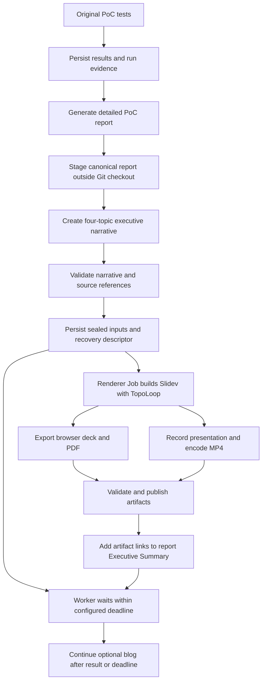

# AutoPoC executive presentation and video design

Status: revised following Astra review; implementation remains on hold.
Updated: 26 October 2026.

## Requested outcome

After AutoPoC generates its PoC report, automatically generate an executive
presentation with Slidev and TopoLoop and a video of that presentation.
The audience is stakeholders and managers. Both outputs must explain:

1. The repository's purpose and the problem it addresses.
2. The testing strategy, including objectives, scope and success criteria.
3. How AutoPoC actually tested it, including deployed setup, execution and results.
4. The report's conclusions about suitability for OpenShift and Kubernetes,
   with required changes, limitations and recommended next steps.

The existing report remains the detailed source. The presentation and video
are executive summaries of that report and its original evidence. Include
links to both outputs in the report's Executive Summary and in a standalone
`executive-summary.md` with the same four sections.

The user explicitly assigned Google TTS voice-over to **Phase 2**. Phase 1
produces a silent video with readable on-screen text. It must work without
TTS credentials or calls.

## Phase 1 output contract

For each run that has a usable report, generate:

- `executive-summary.md`: four requested sections, run identity, report link,
  artifact links and any generation/publication limitation.
- Editable Slidev source, trusted components/assets, a dependency lock file,
  speaker notes and claim-to-evidence index in a downloadable source ZIP.
- A browser presentation built into `dist/`, and `executive-summary.pdf`.
- `executive-summary.mp4`: a recording of the generated presentation including
  the TopoLoop animations. Default 1280x720, 30 fps, H.264, yuv420p and faststart.
- `presentation-manifest.json`: input report/evidence hashes, run ID, renderer
  version, slide timings, output hashes, file sizes, validation status and
  publication links/status for each artifact.
- A sealed `render-inputs.zip` and `recovery.json`, durably stored before
  renderer dispatch. The input ZIP wraps the collector's sealed evidence
  bundle (canonical pre-link report, indexed attempts and sanitized state),
  reviewed narrative JSON, scene manifest, schema/policy/template versions
  and renderer image digest.
  Output publication alone does not satisfy this requirement.

A proposed default is six slides lasting about 2 minutes in total, with a
configurable maximum of 3 minutes. These timing/layout choices are builder
recommendations, not additional user requirements. Use the successful
Omnigent red/charcoal style, local fonts, and retained MIT/OFL licenses.

## Executive narrative

1. **Repository purpose**: project name, purpose, intended users and PoC objective.
2. **Testing strategy**: what we intended to prove, chosen checks and exclusions.
3. **Deployed setup**: a TopoLoop topology derived from recorded resources.
4. **Test execution**: a TopoLoop walkthrough of representative original tests,
   with the test mechanism, observed outcome and relevant recovery actions.
5. **Validation results**: all-scenario totals, important failures and coverage gaps.
6. **OpenShift and Kubernetes suitability**: the report's conclusion, supporting
   evidence, required adaptations and next validation step.

This order implements the four requested topics; setup, execution and results
expand the third topic. Avoid lengthy implementation logs and tool transcripts.
Use notes and source links for technical detail. The video shows the same
claims, caveats and results as the deck, with enough reading time per slide.

Evaluate OpenShift and generic Kubernetes separately. A Route/SCC adjustment
observed on OpenShift does not prove a separate Kubernetes deployment.
Distinguish tested compatibility from inferred portability and untested
production requirements. All-pass smoke tests alone cannot establish
production readiness. Do not invent a suitability score or savings estimate.
If the report conflicts with original evidence, disclose the conflict and
qualify the conclusion instead of repeating the unsupported claim.

## Integration and execution

Keep the existing 11 PoC phases and their outcomes. Add an executive summary
extension after phase 10, with independent reconciliation on every resume.
The worker durably stages its inputs, submits a separate renderer Job and
waits for its result for a configured, bounded period before continuing to the
optional blog. Admission failure, renderer failure or expiration of that wait
records the extension outcome and allows the blog to continue. Blog success
and Google Docs upload do not gate this extension.

**Phase 1 uses a separate renderer Job.** This replaces the in-worker
subprocess recommendation after Astra identified the shared-memory failure
mode. Chromium/ffmpeg must not share the orchestrator's container memory
limit. Keep the standalone renderer CLI for local development and recovery;
local execution does not establish cluster failure isolation.

The renderer image packages Node.js >=22.18, pinned Slidev/TopoLoop,
Chromium and required shared libraries, ffmpeg/ffprobe and local fonts.
Reuse the existing recorder's headless-browser/container patterns, not its
live-console demo or test replay. Validate arbitrary OpenShift UID permissions,
writable caches and CPU-only WebGL. Avoid runtime dependency downloads.

The Job template must define CPU/memory requests and limits, an ephemeral
storage limit, scratch `emptyDir.sizeLimit`, `activeDeadlineSeconds`, cleanup
TTL and `backoffLimit: 0`. The reconciler owns bounded retries. Size the
resource profile from the reference render before rollout; record measured
peak memory, disk usage and elapsed time in cluster acceptance. A command
timeout is not a memory limit. Test forced renderer OOM/timeout and verify
the orchestrator can persist status and continue the blog.

Use a dedicated renderer service account with no workload mutation rights.
The launcher needs scoped Job create/get/watch permissions in the configured
namespace; the renderer needs only access to its input/output artifact
destination. Pass immutable artifact IDs/hashes, never credentials in Job
arguments or logs. Persist Job name/UID and the render revision before waiting.
On controller/worker restart, reconcile the existing Job instead of blindly
creating another one. The renderer publishes result metadata independently,
so a completed render can be recovered after the original worker exits.

Proposed flow:

Failures before dispatch also record an extension outcome and continue to the
optional blog. A renderer result arriving after the worker's wait deadline is
picked up by independent reconciliation.

If the report is missing or unreadable, record `skipped` with the reason.
Do not manufacture conclusions. A failed PoC with a usable failure report is
eligible for the same outputs; outcomes stay failed. An early mandatory-phase
failure that never generates a report remains outside this initial trigger;
manual generation from a later failure report must be supported. Automatic
failure-report finalization is a separate extension, not silently added here.

## Report and artifact lifecycle

Stage each generated report, plan and evaluation immediately in
`$WORK_DIR/evidence/<run_id>/staging/`, outside the source checkout and before
any branch change. This staging area is private; only sanitized, validated
payloads are published. Phase 10 finalizes a canonical report snapshot there
before committing or switching branches. Collection reads that stable copy,
not a `report_path` whose file exists only on `autopoc-artifacts`.

Replace the existing reset/force-push behavior in **all artifact writers**,
including plan, tests, report and blog, with a common persistence protocol:

- Write immutable files under `runs/<run_id>/<kind>/<revision>/` on the artifact
  branch, based on its current remote head. Never reset it from the source branch.
- Preserve previous revisions and other artifact kinds. Use ordinary Git
  commits/pushes; on concurrent changes, fetch and retry boundedly while
  preserving both writers. A conflicting immutable path must fail validation.
- Store small recovery checkpoints and per-kind head pointers with the same
  protocol. A non-fast-forward push is a conflict to reconcile, not permission
  to force-push. Keep the protected default branch untouched.
- Build the report-with-links as a new revision from the canonical pre-link
  report. Replace only a delimited generated-links block, keep the canonical
  bytes/hash unchanged, and persist the report revision and executive head
  pointer together. The blog writer never replaces the report subtree.

This migration is a prerequisite of automatic summary publication. Its
regression test must execute plan → tests → report → executive links → blog
and verify every artifact remains available, including under a competing push.

## Evidence and content generation

Preserve stable run identity, original results, report and plan before the
runner workspace disappears. The evidence collector plan is a dependency of
this design, not the complete executive summary feature.

### Test attempts and final outcomes

Persist an `attempt-index.json` with stable `run_id` and `scenario_id` values.
Each test-script invocation has an `execution_id`; each actual HTTP/CLI/exec
attempt has an `attempt_id`, sequence number, mechanism, start/end timestamps,
duration, outcome, sanitized failure details and a hashed payload reference.
Internal HTTP retries must emit structured records too; stderr alone is not
the source of retry history. Record an interruption explicitly if a scenario
never produces a final outcome.

The collector consumes this index and includes every referenced attempt.
Store a separate `final_execution_id` once the PoC chooses the completed
validation execution. Final totals include one terminal outcome per planned
scenario in that execution; absent outcomes are marked missing, never passed.
Earlier failed executions and retries remain in history, even if the final
execution passes. If no final execution exists, mark results incomplete and
show the last observed outcomes without claiming a completed validation.
For historical imports such as Omnigent, explicitly label unavailable attempt
history; do not infer it from a final result or regenerate it by replay.

Use the existing configured OpenCode model to produce a validated narrative
JSON from the report, plan and results. Do not add a separate LLM provider.
Each claim references its report section or an indexed original evidence file.
Store full input hashes; the report hash is taken before adding output links
so retries can identify the same source without a circular hash dependency.
After collection and narrative review, seal the final render input bundle
around the evidence bundle plus reviewed narrative and scene data;
recovery must not require another model call to reproduce an existing render
revision. Record the exact renderer image/template version used.

The JSON schema separates `purpose`, `testing_strategy`, `test_execution`
and `platform_suitability`; results and topology are structured fields.
Compute counts/statuses/durations from original results. Preserve failures,
errors, skipped tests, retries and missing media. The model writes concise
prose and notes; deterministic code validates structure, totals, citations,
limits and render inputs. An automated content review by the existing model
checks consistency with the report; reference validation alone cannot prove
prose is true. Both the content review and publication checks run unattended.
Do not add a per-run human approval gate. Unknown schema/policy versions,
unresolved citation conflicts, or secret-scan failures block publication and
record an independent failure. Human review belongs to initial feature
acceptance and configuration of the destination's access policy.

Keep raw responses, secrets, credential files and unreviewed logs out of public
assets. Treat report/repository text as untrusted content. Render narrative
as escaped text in trusted components; never execute model-written Vue,
JavaScript, shell commands or directives taken from a report.

TopoLoop specs must describe actual recorded HTTP/CLI/exec mechanisms. Do not
force a runner/Route/Service/server path onto CLI-only or library projects.
Label animation timing as illustrative. Limit graph size and representative
scenario count for readability; aggregate totals still cover all tests and
identify any omitted individual walkthroughs. Use a static resource list or
diagram when evidence cannot support a meaningful animated graph. Test
failures use a negative tone, skipped tests remain distinct from passes.

## Video generation

Record an automated walkthrough of the built deck in Playwright, waiting for
fonts/assets and a renderer-ready signal before each scene. Animate TopoLoop
for its scheduled scene duration. Hide navigation controls and editing UI.
Close the browser context to finalize the video, then encode the final MP4
with ffmpeg. Inspect output with ffprobe and validate duration, dimensions,
codec and nonempty frames before marking it complete.

The recorded video is an explanation of archived run evidence. It is not a
recording of original PoC tests and does not require replaying them. Never
present missing browser traces or test recordings as available media.

Keep a scene manifest with slide IDs, text/captions, start times and durations.
Each scene has an explicit ready/error signal after its fonts, assets and
TopoLoop canvas initialize. Start the capture interval only after readiness;
timeouts fail that scene instead of recording an empty/loading screen. Reset
animation time at scene entry, record actual capture boundaries, and trim
initial loading/finalization frames before encoding. Validate output duration
against the scene manifest, including transitions, rather than wall-clock
browser startup time. PDF export uses a specified still frame for each graph.
Phase 2 will use this manifest to align Google TTS speech and scene timing.
No TTS integration, synthesis charges or voice selection are part of Phase 1.

## Publication and state

Extend the existing Google Drive uploader when a destination folder and
credentials are configured. Publish the sealed input bundle and initial
recovery descriptor **before dispatching the renderer**. Verify they can be
retrieved and their hashes match. Record their IDs in a run-specific Git
recovery checkpoint so they remain discoverable without the worker workspace.
Then publish the MP4, PDF, source/static-site ZIP and output manifest, returning
actual viewer/download links. Include the sealed inputs and recovery metadata
in the source ZIP as well, but do not rely on that later ZIP for initial recovery.
A ZIP containing `dist/` is downloadable, not a hosted browser presentation.
A standalone web URL requires a separately configured host.

Give every binary upload a durable intent keyed by run ID, render revision,
artifact kind and content hash. Pre-generate its Drive file ID and persist
that intent in the recovery checkpoint before uploading. Retries use the same
ID. On timeout or an already-existing response, retrieve and verify the file
before recording success; do not blindly create another file. This requires
extending the current uploader, which always calls `files.create` with a new
ID. See [Drive pre-generated upload IDs](https://developers.google.com/workspace/drive/api/guides/manage-uploads).

For local use, write artifacts to a caller-selected output directory. Without
a publisher, mark them `generated_unpublished`; report local paths with that
label instead of inventing shareable URLs. A directory in the runner's
`emptyDir` is not durable storage. Cluster acceptance requires a configured
publisher or durable mounted destination. Public upload is not implicit.
If durable input staging is unavailable, mark cluster dispatch
`blocked_storage` and continue the PoC workflow. Local preview generation
remains available, but must not be reported as a recoverable cluster run.
The initial cluster implementation uses the configured Drive destination plus
Git recovery checkpoints; adding other storage adapters is separate work.

Record an independent `executive_summary` block with collection, narrative,
input publication, render, deck, PDF, video, output publication and report-link
statuses. Include attempt history, input hashes, Job identity, artifact IDs,
paths/URLs and sanitized errors. A failed video must not hide a valid deck or
change PoC outcomes. New rendering attempts write distinct revisions; retries
within a revision reuse its known validated artifacts and upload intents.

### Resume and reconciliation

On every startup/resume, reconcile eligible executive revisions independently
of `project.current_phase`, including when phase 10 or the blog is already
complete. Also expose a standalone reconcile/retry command taking a durable
recovery reference, so recovery works after the original Job and workspace
have been deleted. Never rerun PoC validation as part of this operation.

The durable checkpoint records the input identity and these boundaries:
`collected`, `narrative_validated`, `inputs_published`, `render_submitted`,
per-artifact `validated`, per-artifact `published`, and `report_links_persisted`.
Write upload/Job intents before external side effects. Reconcile an
`in_progress` checkpoint against actual Job/provider state, not by assuming
failure or starting a duplicate operation. Persist sanitized failures with a
bounded retry count. An automatic retry policy and an explicit retry command
may resume failed stages; neither resets completed PoC phases.

Report-link publication is a separate checkpoint. If artifacts upload but the
Git push fails, retry only link persistence. If the video fails, publish and
link validated deck/PDF outputs with video failure noted. A revision is fully
complete only when required Phase 1 outputs and their report links are durable;
otherwise retain an explicit partial, failed, skipped or storage-blocked state.

## Acceptance and review

- Automatically create deck/PDF/MP4 through the separate renderer Job for a usable report.
- Verify the same four topics appear in the summary, deck and video scenes.
- Use Omnigent as the historical reference; its state is a reconstruction.
  Verify all five original HTTP outcomes and the original evidence limitations.
- Test a failed run, skipped/error results, no report, no topology, CLI-only
  testing and a larger test suite. No false passes or invented infrastructure.
- Check malicious input handling, credential redaction, hashes, independent
  failures, bounded timeouts, and resume without rerunning PoC validation.
- Execute the entire report → executive extension → blog sequence and verify
  the canonical report, revised report links and earlier artifacts survive.
- Preserve failure → retry → pass history, including internal HTTP retries,
  while final totals count scenarios once and incomplete results stay explicit.
- Delete the original worker workspace/Job and reconstruct a render revision
  using only the durable recovery reference and published input material.
- Interrupt after phase-10 completion, narrative validation, renderer dispatch,
  each upload, and before/after report-link persistence. Resume even after the
  blog completed; verify no duplicate uploads, lost links or PoC test replay.
- Force renderer OOM, scratch-space exhaustion, Job timeout and admission
  failure; verify the orchestrator retains status and the blog can proceed.
- Visually inspect every slide/PDF page and selected video frames, including
  animated scenes; confirm no blank canvas, clipping or illegible labels.
- Verify durable artifact links in the report when publishing is configured;
  test generated-unpublished behavior and partial upload failure separately.
- Execute one cluster acceptance run with the renderer image/Job before
  claiming deployment integration is validated. A local sample alone is insufficient.

## References

- [Session handoff](../../report-presentation-plan.md)
- [Evidence collector plan](../plans/2026-10-26-presentation-evidence.md)
- [Sample presentation](../../../presentations/omnigent-2026-10-20/README.md)
- [Current run-poc skill](../../../.opencode/skills/run-poc/SKILL.md)
- [Existing recorder](../../../.opencode/skills/record-demo/SKILL.md)
- [Slidev export documentation](https://sli.dev/guide/exporting.html)
- [Playwright video recording](https://playwright.dev/docs/videos)
- [FFmpeg MP4 options](https://ffmpeg.org/ffmpeg-formats.html#mov_002c-mp4_002c-ismv)

## Design review

The initial builder review clarified unattended content/publication checks.
A subsequent Astra review found six gaps. This revision addresses them in
the design and synchronized plans:

1. Report loss: stable staging and common append-only artifact persistence.
2. Recovery loss: durable sealed inputs and a discoverable recovery descriptor.
3. Attempt loss: indexed execution/attempt history with separate final totals.
4. Resume gaps: independent reconciliation and durable side-effect intents.
5. Resource failure: separate renderer Job and forced-failure acceptance tests.
6. Plan conflict: silent video is explicitly part of the active Phase 1 work.

These are documented corrections, not implemented or deployment-validated
capabilities. Implementation remains on hold during the user's review.
