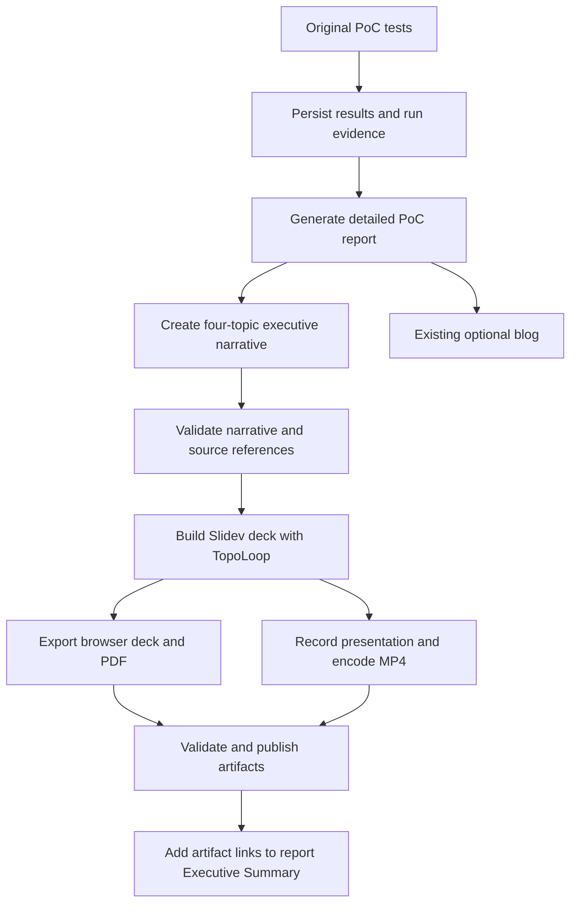

# AutoPoC executive presentation and video design

Status: design for review; implementation has not started.
Updated: 26 October 2026.

## Requested outcome

After AutoPoC generates its PoC report, automatically generate an executive
presentation with Slidev and TopoLoop and a video of that presentation.
The audience is stakeholders and managers. Both outputs must explain:

1. The repository's purpose and the problem it addresses.
2. The testing strategy, including objectives, scope and success criteria.
3. How AutoPoC actually tested it, including deployed setup, execution and results.
4. The report's conclusions about suitability for OpenShift and Kubernetes,
   with required changes, limitations and recommended next steps.

The existing report remains the detailed source. The presentation and video
are executive summaries of that report and its original evidence. Include
links to both outputs in the report's Executive Summary and in a standalone
`executive-summary.md` with the same four sections.

The user explicitly assigned Google TTS voice-over to **Phase 2**. Phase 1
produces a silent video with readable on-screen text. It must work without
TTS credentials or calls.

## Phase 1 output contract

For each run that has a usable report, generate:

- `executive-summary.md`: four requested sections, run identity, report link,
  artifact links and any generation/publication limitation.
- Editable Slidev source, trusted components/assets, a dependency lock file,
  speaker notes and claim-to-evidence index in a downloadable source ZIP.
- A browser presentation built into `dist/`, and `executive-summary.pdf`.
- `executive-summary.mp4`: a recording of the generated presentation including
  the TopoLoop animations. Default 1280x720, 30 fps, H.264, yuv420p and faststart.
- `presentation-manifest.json`: input report/evidence hashes, run ID, renderer
  version, slide timings, output hashes, file sizes, validation status and
  publication links/status for each artifact.

A proposed default is six slides lasting about 2 minutes in total, with a
configurable maximum of 3 minutes. These timing/layout choices are builder
recommendations, not additional user requirements. Use the successful
Omnigent red/charcoal style, local fonts, and retained MIT/OFL licenses.

## Executive narrative

1. **Repository purpose**: project name, purpose, intended users and PoC objective.
2. **Testing strategy**: what we intended to prove, chosen checks and exclusions.
3. **Deployed setup**: a TopoLoop topology derived from recorded resources.
4. **Test execution**: a TopoLoop walkthrough of representative original tests,
   with the test mechanism, observed outcome and relevant recovery actions.
5. **Validation results**: all-scenario totals, important failures and coverage gaps.
6. **OpenShift and Kubernetes suitability**: the report's conclusion, supporting
   evidence, required adaptations and next validation step.

This order implements the four requested topics; setup, execution and results
expand the third topic. Avoid lengthy implementation logs and tool transcripts.
Use notes and source links for technical detail. The video shows the same
claims, caveats and results as the deck, with enough reading time per slide.

Evaluate OpenShift and generic Kubernetes separately. A Route/SCC adjustment
observed on OpenShift does not prove a separate Kubernetes deployment.
Distinguish tested compatibility from inferred portability and untested
production requirements. All-pass smoke tests alone cannot establish
production readiness. Do not invent a suitability score or savings estimate.
If the report conflicts with original evidence, disclose the conflict and
qualify the conclusion instead of repeating the unsupported claim.

## Integration and execution

Keep the existing 11 phases. Add a named, non-blocking executive summary
extension after phase 10 report finalization, before or independently of the
optional blog. Blog success and Google Docs upload do not gate this extension.

The first implementation will invoke a bounded renderer subprocess inside an
executive-enabled AutoPoC worker image. This is a builder recommendation:
it can read the original workspace without adding a shared-volume or object
storage handoff between Jobs. The earlier handoff's separate renderer Job is
an optional later deployment pattern once durable evidence storage is ready.
Keep a standalone renderer CLI so either execution model can reuse it.

The extended worker image packages Node.js >=22.18, pinned Slidev/TopoLoop,
Chromium and required shared libraries, ffmpeg/ffprobe and local fonts.
Reuse the existing recorder's headless-browser/container patterns, not its
live-console demo or test replay. Validate arbitrary OpenShift UID permissions,
writable caches and CPU-only WebGL. Avoid runtime dependency downloads.

Proposed flow:

If the report is missing or unreadable, record `skipped` with the reason.
Do not manufacture conclusions. A failed PoC with a usable failure report is
eligible for the same outputs; outcomes stay failed. An early mandatory-phase
failure that never generates a report remains outside this initial trigger;
manual generation from a later failure report must be supported. Automatic
failure-report finalization is a separate extension, not silently added here.

## Evidence and content generation

Preserve stable run identity, original results, report and plan before the
runner workspace disappears. The evidence collector plan is a dependency of
this design, not the complete executive summary feature.

Use the existing configured OpenCode model to produce a validated narrative
JSON from the report, plan and results. Do not add a separate LLM provider.
Each claim references its report section or an indexed original evidence file.
Store full input hashes; the report hash is taken before adding output links
so retries can identify the same source without a circular hash dependency.

The JSON schema separates `purpose`, `testing_strategy`, `test_execution`
and `platform_suitability`; results and topology are structured fields.
Compute counts/statuses/durations from original results. Preserve failures,
errors, skipped tests, retries and missing media. The model writes concise
prose and notes; deterministic code validates structure, totals, citations,
limits and render inputs. An automated content review by the existing model
checks consistency with the report; reference validation alone cannot prove
prose is true. Both the content review and publication checks run unattended.
Do not add a per-run human approval gate. Unknown schema/policy versions,
unresolved citation conflicts, or secret-scan failures block publication and
record an independent failure. Human review belongs to initial feature
acceptance and configuration of the destination's access policy.

Keep raw responses, secrets, credential files and unreviewed logs out of public
assets. Treat report/repository text as untrusted content. Render narrative
as escaped text in trusted components; never execute model-written Vue,
JavaScript, shell commands or directives taken from a report.

TopoLoop specs must describe actual recorded HTTP/CLI/exec mechanisms. Do not
force a runner/Route/Service/server path onto CLI-only or library projects.
Label animation timing as illustrative. Limit graph size and representative
scenario count for readability; aggregate totals still cover all tests and
identify any omitted individual walkthroughs. Use a static resource list or
diagram when evidence cannot support a meaningful animated graph. Test
failures use a negative tone, skipped tests remain distinct from passes.

## Video generation

Record an automated walkthrough of the built deck in Playwright, waiting for
fonts/assets and a renderer-ready signal before each scene. Animate TopoLoop
for its scheduled scene duration. Hide navigation controls and editing UI.
Close the browser context to finalize the video, then encode the final MP4
with ffmpeg. Inspect output with ffprobe and validate duration, dimensions,
codec and nonempty frames before marking it complete.

The recorded video is an explanation of archived run evidence. It is not a
recording of original PoC tests and does not require replaying them. Never
present missing browser traces or test recordings as available media.

Keep a scene manifest with slide IDs, text/captions, start times and durations.
Phase 2 will use this manifest to align Google TTS speech and scene timing.
No TTS integration, synthesis charges or voice selection are part of Phase 1.

## Publication and state

Reuse the existing Google Drive uploader when a destination folder and
credentials are configured, consistent with the recorder's publication path.
Publish the MP4, PDF and source/static-site ZIP; return the actual viewer or
download links. A ZIP containing `dist/` is downloadable, not a hosted browser
presentation. A standalone web URL requires a separately configured host.

For local use, write artifacts to a caller-selected output directory. Without
a publisher, mark them `generated_unpublished`; report local paths with that
label instead of inventing shareable URLs. A directory in the runner's
`emptyDir` is not durable storage. Cluster acceptance requires a configured
publisher or durable mounted destination. Public upload is not implicit.

Record an independent `executive_summary` block with collection, deck, PDF,
video and publication statuses, attempt history, input hashes, paths/URLs and
sanitized errors. A failed video must not hide a valid deck or change PoC
outcomes. Upload retries reuse validated artifacts. New rendering attempts
write distinct revisions; old evidence and delivered outputs stay unchanged.
Update only the generated link block in report section 1, idempotently, without
replacing the original narrative. Preserve the existing fork/default-branch
policy; this step must not force-push or reset shared artifact history.

## Acceptance and review

- Automatically create deck/PDF/MP4 for a report in the executive-enabled worker.
- Verify the same four topics appear in the summary, deck and video scenes.
- Use Omnigent as the historical reference; its state is a reconstruction.
  Verify all five original HTTP outcomes and the original evidence limitations.
- Test a failed run, skipped/error results, no report, no topology, CLI-only
  testing and a larger test suite. No false passes or invented infrastructure.
- Check malicious input handling, credential redaction, hashes, independent
  failures, bounded timeouts, and resume without rerunning PoC validation.
- Visually inspect every slide/PDF page and selected video frames, including
  animated scenes; confirm no blank canvas, clipping or illegible labels.
- Verify durable artifact links in the report when publishing is configured;
  test generated-unpublished behavior and partial upload failure separately.
- Execute one cluster acceptance run with the executive-enabled image before
  claiming deployment integration is validated. A local sample alone is insufficient.

## References

- [Session handoff](../../report-presentation-plan.md)
- [Evidence collector plan](../plans/2026-10-26-presentation-evidence.md)
- [Sample presentation](../../../presentations/omnigent-2026-10-20/README.md)
- [Current run-poc skill](../../../.opencode/skills/run-poc/SKILL.md)
- [Existing recorder](../../../.opencode/skills/record-demo/SKILL.md)
- [Slidev export documentation](https://sli.dev/guide/exporting.html)
- [Playwright video recording](https://playwright.dev/docs/videos)
- [FFmpeg MP4 options](https://ffmpeg.org/ffmpeg-formats.html#mov_002c-mp4_002c-ismv)

## Design review

A fresh builder review found one ambiguity: whether content/publication
review introduces human approval on each run. The design now specifies
automated checks for configured unattended publication. No other material
unanswered implementation questions remained. Design approval and the
implementation plan are still pending; no runtime changes are claimed.
