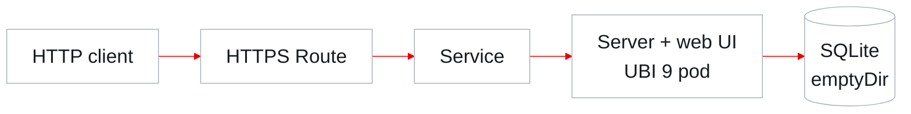

AutoPoC run review · 20 October 2026

# Omnigent on OpenShift

A working agent control plane, built and validated through AutoPoC

  

11

phases completed

  

5/5

HTTP checks passed

  

94m 31s

complete job duration

Run autopoc-omnigent-8554 · <a href="/evidence/run-summary.json">Job evidence</a> · <a href="/evidence/test-results.json">Original test results</a>

<!--
This presentation reviews one actual run, not a projection of future capability.
The runner job began at 06:42:35 UTC and completed at 08:17:06 UTC on 20 October
2026 with exit code zero. All 11 phases completed according to the run record.
The five checks are deliberately limited HTTP smoke tests. Total job time
includes report generation, blog reviews and artifact recovery.
Sources: public/evidence/run-summary.json; public/evidence/test-results.json;
public/evidence/runner.sanitized.log.gz. Pinned report:
https://github.com/aicatalyst-team/omnigent/blob/f2d3c4d8183de4d67f5a2cb3135c3b653211f6e6/poc-report.md
-->

---
layout: default
---

The opportunity

# A common control plane for coding agents

Omnigent brings agent sessions, policies and a web interface into a shared service.

AutoPoC tested whether that service can run as a standard OpenShift workload.

Actual coding-agent work runs on separately registered hosts. This PoC focused on the coordinating server.

74/100

AutoPoC suitability score

<ul class="scope-list small">
<li><strong>Primary fit</strong> Agentic AI orchestration</li>
<li><strong>Secondary fit</strong> Management, observability and security</li>
<li><strong>Relationship</strong> Adjacent to OpenShift AI</li>
</ul>

<a href="/evidence/intake.md">Repository analysis</a> · <a href="/evidence/evaluation.md">AutoPoC evaluation</a> · Score is an agent assessment, not an independent benchmark

<!--
The archived evaluation calculated 73.9/100, rounded to 74 in the report.
Omnigent offers a common orchestration layer over multiple agent harnesses.
Its reported policy and governance features are product context, not features
that this run functionally validated. The evaluation recommends a server-only
scope because the full system also includes external agent hosts.
Source: https://github.com/aicatalyst-team/omnigent/blob/f2d3c4d8183de4d67f5a2cb3135c3b653211f6e6/.autopoc/rhoai-evaluation.md
-->

---
layout: default
---

PoC scope

# One service, five measurable checks

<h2>What the run demonstrated</h2>
<ul class="scope-list">
<li>A UBI 9 container built on OpenShift</li>
<li>A non-root server with its web UI</li>
<li>A reachable HTTPS application route</li>
<li>Five expected HTTP responses</li>
</ul>

<h2>What remains to validate</h2>
<ul class="scope-list muted">
<li>Authenticated user and agent workflows</li>
<li>LLM or model-serving integration</li>
<li>Durable data and recovery</li>
<li>Load, availability and security behavior</li>
</ul>

Deployment feasibility is established for the tested control-plane scope.

<a href="/evidence/plan.md">Original plan</a> · <a href="/evidence/report.md">Final report</a> · <a href="/evidence/poc_test.py.txt">Executed test script</a>

<!--
The plan proposed persistent storage. The deployed configuration switched to
emptyDir, so this deck does not repeat the report's broad durability and
production-readiness wording. HTTP checks on the root and login paths assert
HTML response text. They do not prove that the UI rendered in a browser or that
a user could authenticate. No GPU or model inference was needed for startup.
Sources: public/evidence/plan.md; report.md; deployment.yaml; poc_test.py.
-->

---
layout: default
---

AutoPoC workflow

# Eleven phases produced a complete PoC record

<h2>Understand and plan</h2>
<ol><li>01Intake</li><li>02Evaluate</li><li>03Fork</li><li>04PoC plan</li></ol>

<h2>Build and deploy</h2>
<ol><li>05Containerize</li><li>06Build and push</li><li>07Generate manifests</li><li>08Apply and verify</li></ol>

<h2>Validate and explain</h2>
<ol><li>09Execute tests</li><li>10Write report</li><li>11Create blog</li></ol>

AutoPoC diagnosed build and deployment failures, revised artifacts and continued.

<a href="/evidence/report.md">Pipeline execution report</a> · <a href="/evidence/execution-events.json">Timestamped execution events</a>

<!--
The runner used OpenCode skill instructions to execute these phases. The
monitoring agent only observed and made no changes. The recovery claim refers
to the launched AutoPoC agent's actions. It does not imply that every generated
decision or cleanup action was safe or production-ready. See the appendix for
cleanup and permission caveats.
Source: public/evidence/runner.sanitized.log.gz; report.md, section 4.
-->

---
layout: default
---

Original run timeline

# Deployment and checks finished before documentation

<time>06:42</time>
Run started

<time>07:05</time>
First image build started

<time>07:13</time>
Build failed on unavailable package

<time>07:24</time>
Second build completed and pushed

<time>07:42</time>
All five HTTP checks passed

<time>08:17</time>
Job completed after report and blog work

59m 49s

From job start to the logged five-test result

<strong>8m 08s</strong> first build

<strong>8m 57s</strong> successful retry

Times shown in UTC. In Jerusalem, add three hours.

Remaining job time includes documentation, reviews and artifact finalization.

<a href="/evidence/run-summary.json">Kubernetes job/build timestamps</a> · Runner test result logged at 07:42:23 UTC · Durations describe this single run

<!--
Exact anchors: start 06:42:35; build 1 07:05:29–07:13:37; build 2
07:15:57–07:24:54; the agent logged all-five-passed at 07:42:23.517;
job completion 08:17:06. Start to the test-result log is 59m48.517s, rounded
to 59m49s. These are observed elapsed times, not performance benchmarks or
operator-hours saved. Tool output timestamps can reflect output emission.
Sources: run-summary.json; runner.sanitized.log.gz, line 4616.
-->

---
layout: default
---

Deployed architecture

# A single OpenShift service with temporary storage

<h2>1 pod</h2>
Control plane on port 8000

<h2>No GPU</h2>
No model required for startup

<h2>1 CPU / 2 GiB</h2>
Configured resource limits

SQLite data is lost when the pod is replaced. Persistence is a next-step requirement.

<a href="/evidence/deployment.yaml">Corrected deployment manifest</a> · <a href="/evidence/report.md">Infrastructure report</a> · Namespace: poc-omnigent

<!--
This is the actual PoC architecture. Requests are 500m CPU and 1 GiB memory.
Limits are 1 CPU and 2 GiB memory. They are configured capacity, not measured
utilization. The original plan described a 10 GiB PVC. The actual deployment
uses an emptyDir volume at /data. Agent hosts and models are omitted from the
diagram because they were not part of the deployed/validated path.
Sources: public/evidence/deployment.yaml; report.md, section 6.
-->

---
layout: none
---

<RunTopoLoop kind="setup" />

<!--
Animated setup topology reconstructed from this run's source, build and
deployment artifacts. Three ten-second acts illustrate build/push, deployment
and access through Route/Service. Animation timing is illustrative; original
build durations and job timestamps remain in the evidence slides. Edges show
build/deployment relationships as well as request routing; they are not packet
captures. Labels identify runner, build and deployed application namespaces.
Only the server and UI are deployed; no model or external agent host is shown.
The SQLite store is emptyDir and not durable. Log lines prefixed with # are
explanatory reconstruction, while other excerpts quote the archived logs.
Sources: public/evidence/deployment.yaml; report.md; run-summary.json;
build-1.sanitized.log.gz; build-2.sanitized.log.gz; runner.sanitized.log.gz.
Renderer: https://github.com/r-bit-rry/topoloop/tree/8631cf7955ebf40a579aab4ce3d0cca50d215c21
The PDF freezes this animation at second 7. A still-frame/play control is
available in the browser, and reduced-motion preference starts on the still.
Labels follow the active path to keep each stage readable; the animation
reveals all eight resources across its three acts. The preceding architecture
slide retains the complete static serving/storage topology for PDF readers.
-->

---
layout: none
---

<RunTopoLoop kind="scenarios" />

<!--
Five ten-second acts illustrate the five original pre-auth HTTP checks in
order: health, version, server info, root HTML and login HTML. All requests
follow the same test runner, HTTPS Route, Service and server path. The graph
does not claim a measured distributed trace or database operation. Durations
and statuses are read from archived original-run test-results.json. The
browser does not issue test requests: this is an animated reconstruction.
No user authentication, agent execution or JavaScript UI action was validated.
The PDF freezes the final act at second 47 with all five original outcomes on
the status board. Lines prefixed # are explanatory, not original log lines.
Sources: public/evidence/test-results.json; poc_test.py.txt; report.md.
-->

---
layout: default
---

Failure recovery

# Three blockers, three concrete responses

<article>
<h2>Repository permissions</h2>

GitHub rejected the fork update because the access token could not change workflow files.

Excluded upstream CI workflows from the PoC branch

Branch protection and tag updates remained limited.

</article>
<article>
<h2>Image build</h2>

An unused Dockerfile stage required <code>tmux</code>, unavailable from the configured UBI repositories.

Built only the server-related stages

Second build completed successfully.

</article>
<article>
<h2>OpenShift admission</h2>

The generated group setting conflicted with the cluster’s security constraints.

Used the namespace’s allowed group and revised the security context

Rollout reached one ready pod.

</article>

<a href="/evidence/report.md">Failure/recovery record</a> · <a href="/evidence/build-1.sanitized.log.gz">First build log</a> · <a href="/evidence/build-2.sanitized.log.gz">Successful build log</a>

<!--
This run demonstrates recovery behavior, with important tradeoffs. Removing CI
workflows is a PoC workaround, not a recommended production permission policy.
The build error was DockerBuildFailed with no match for tmux. The SCC diagnosis
found fsGroup 0 invalid. The corrected manifest uses fsGroup 1001480000,
hostUsers false under pod securityContext and runAsNonRoot true for the
container. Namespace deletion attempts also failed due to RBAC. The agent
then cleaned old resources in the existing namespace. See the appendix.
Sources: report.md, sections 4 and 9; both build logs; runner log.
-->

---
layout: default
---

Validation results

# All five HTTP smoke checks passed

<table>
<thead><tr><th>Scenario</th><th>Endpoint</th><th>Result</th><th>Observed duration</th></tr></thead>
<tbody>
<tr><td>Health</td><td><code>/health</code></td><td class="status">PASS</td><td>0.05 s</td></tr>
<tr><td>Version</td><td><code>/api/version</code></td><td class="status">PASS</td><td>0.02 s</td></tr>
<tr><td>Server information</td><td><code>/v1/info</code></td><td class="status">PASS</td><td>0.02 s</td></tr>
<tr><td>Web application HTML</td><td><code>/</code></td><td class="status">PASS</td><td>0.02 s</td></tr>
<tr><td>Login page HTML</td><td><code>/login</code></td><td class="status">PASS</td><td>0.02 s</td></tr>
</tbody>
</table>

Original-run results extracted from the runner log. Durations are single observations, not load-test measurements.

The tests checked status codes and response text. User login and agent execution remain untested.

<a href="/evidence/test-results.json">Original test JSON</a> · <a href="/evidence/poc_test.py.txt">Executed test script</a>

<!--
The original JSON emitted total 5, passed 5, failed 0. The script exited zero.
Checks expect HTTP 200 and substrings: ok, version, server_version, html, html.
The server-info test did not assert accounts_enabled, although the report
describes that response field. The two HTML checks do not execute JavaScript.
These timing values are request-attempt elapsed seconds from the script, not
percentiles, throughput, repeated benchmarks, or service-level objectives.
Sources: public/evidence/test-results.json; poc_test.py.
-->

---
layout: default
---

Generated outcomes

# A deployed app and a reviewable evidence package

Captured after the run, 20 October 2026. First administrator setup is still pending. No account was created.

<h2>Application and deployment</h2>

<a href="https://omnigent-poc-omnigent.apps.ocp-gb.ibm.redhataicatalyst.com">Open the deployed application</a> UBI image, Dockerfile and manifests

<h2>Validation package</h2>

<a href="/evidence/plan.md">PoC plan</a>, <a href="/evidence/poc_test.py.txt">executable tests</a> and <a href="/evidence/test-results.json">original results</a>

<h2>Generated reports</h2>

<a href="https://github.com/aicatalyst-team/omnigent/blob/autopoc-artifacts/poc-report.md">PoC report</a> and <a href="https://github.com/aicatalyst-team/omnigent/blob/autopoc-artifacts/.autopoc/blog/final.md">reviewed blog</a>

Snapshot pinned to GitHub commit f2d3c4d8183 · <a href="/evidence/index.json">Evidence index and source links</a>

<!--
The artifact branch temporarily lost earlier artifact-only commits through
reset/push behavior. The agent recovered the plan, test and report from git
reflog and rebuilt the artifact branch. We verified the final snapshot contains
the artifacts cited here. The UI screenshot was captured after the run and is
illustrative only, with capture metadata under public/assets/capture.json.
No original test was replayed and no admin form was submitted.
Blog v3 received an agent-review score of 8.76. Its
final terminology lint had no errors but retained warnings. Google Docs upload
failed, so GitHub is the available outcome location. Links to the live app
depend on the cluster retaining the deployment. Source snapshots are pinned.
Source: index.json; archived report/blog; original runner log finalization.
-->

---
layout: default
class: dark
---

Decision boundaries

# A successful PoC with follow-up work

<h2>Application readiness</h2>
<ul class="scope-list small">
<li><strong>Temporary storage</strong> Pod replacement loses database and artifact data.</li>
<li><strong>Functional coverage</strong> Login, agent sessions and inference need end-to-end tests.</li>
<li><strong>Operations</strong> Availability, load and recovery behavior need validation.</li>
</ul>

<h2>Automation readiness</h2>
<ul class="scope-list small">
<li><strong>Source synchronization</strong> Corrected manifest is archived, but source branch stayed stale.</li>
<li><strong>Evidence hygiene</strong> Raw logs exposed credentials. Shared logs require redaction.</li>
<li><strong>Trace coverage</strong> No run-specific browser or distributed trace export was found.</li>
</ul>

<a href="/evidence/run-summary.json">Evidence availability</a> · <a href="/evidence/deployment.yaml">Actual storage/security configuration</a> · Finalization history in runner log

<!--
Avoid presenting the report's “Production readiness: Strong” assessment as a
validated outcome. This run validates a smaller scope. The final source
autopoc branch remained at 8ef9effd1 with the older fsGroup zero configuration,
while the corrected manifest is archived on autopoc-artifacts. This is a
historical final-state observation, not a guarantee about future branch state.
Raw credentials were excluded from this presentation package. No original
Playwright screenshots, video, trace.zip, or distributed trace export appeared
in the generated run artifacts. Logs preserve tool activity, which is distinct
from a distributed tracing export.
Sources: runner log, finalization; deployment.yaml; run-summary.json.
-->

---
layout: default
---

Stakeholder value

# The run makes the next investment more concrete

<ol class="steps">
<li>
<h2>Reduce uncertainty about hosting</h2>
A working UBI/OpenShift deployment establishes a practical starting point.

</li>
<li>
<h2>Make engineering obstacles visible</h2>
Repository permissions, build dependencies and cluster security surfaced in a real run.

</li>
<li>
<h2>Carry evidence into the decision</h2>
The deployment, test results, report and failure history can be inspected together.

</li>
</ol>

The case for a deeper pilot rests on demonstrated deployment feasibility and clear remaining tests.

Assessment based on this run’s documented outcomes · No comparative labor, cost or productivity baseline was measured

<!--
These are implications of the observed evidence, not measured business ROI.
No human-hours-saved figure, cost saving, productivity gain, or comparison with
manual deployment is claimed. The suitability score is an AutoPoC assessment.
The management decision is whether to fund a bounded next pilot, not whether
the application is already ready for production adoption.
Sources: archived report, test results and original execution evidence.
-->

---
layout: default
class: dark
---

Recommended next decision

# Proceed to a bounded functional pilot

Validate a real authenticated agent workflow with durable storage.

<ol class="steps">
<li>
<strong>Establish a reproducible baseline</strong>
Synchronize the corrected manifest, review permissions and constrain cleanup.

</li>
<li>
<strong>Prove the complete user journey</strong>
Configure identity and storage, register a host and execute an agent session.

</li>
<li>
<strong>Capture evidence during the test</strong>
Save screenshots, selected browser traces and results, then validate recovery.

</li>
</ol>

Proposed next steps, not work completed in this run · <a href="https://github.com/aicatalyst-team/omnigent/tree/autopoc-artifacts">Open the run artifacts</a>

<!--
Suggested pilot acceptance criteria: an authenticated user starts a real agent
task via a registered host; expected results are visible; backing data survives
pod replacement; permission boundaries and cleanup scope are reviewed; and
scenario-linked evidence is saved. Record any later tests as a new validation
run. This proposal does not assign dates, owners or budgets that were not
provided by the user. Main presentation ends here. Remaining slides are a
technical evidence appendix for questions and follow-up.
Source: report.md recommendations; plan versus deployed manifest comparison.
-->

---
layout: default
---

Appendix A · Evidence library

# Inspect the original sources

<h2>Run and validation</h2>

<a href="/evidence/run-summary.json">Job and build timestamps</a> <a href="/evidence/test-results.json">Original test result JSON</a> <a href="/evidence/poc_test.py.txt">Executed test script</a> <a href="/evidence/execution-events.json">Timestamped log events</a>

<h2>Sanitized execution logs</h2>

<a href="/evidence/runner.sanitized.log.gz">Runner log (.gz)</a> <a href="/evidence/build-1.sanitized.log.gz">Failed build log (.gz)</a> <a href="/evidence/build-2.sanitized.log.gz">Successful build log (.gz)</a>

<h2>Generated artifacts</h2>

<a href="/evidence/intake.md">Intake analysis</a> <a href="/evidence/evaluation.md">Fitness evaluation</a> <a href="/evidence/plan.md">PoC plan</a> <a href="/evidence/report.md">PoC report</a> <a href="/evidence/blog.md">Final blog</a> <a href="/evidence/deployment.yaml">Corrected deployment</a>

Pinned snapshot: f2d3c4d8183 <a href="/evidence/index.json">Source URLs, hashes and claim index</a>

Local evidence links work while serving the browser deck. Original GitHub URLs and hashes are retained in the index.

<!--
Every named file is included under the deck's public/evidence directory and
copied into the static browser build. Gzip logs preserve sanitized text rather
than raw credentials. Detailed command/event output is available for technical
review without putting it on the management slides. The report, plan, script
and blog are snapshots of generated artifacts, not rewritten source reports.
Source: public/evidence/index.json.
-->

---
layout: default
---

Appendix B · Recovery details

# Build and security-context evidence

<h2>Build failure and recovery</h2>
<pre>Build 1: Failed&#10;07:05:29–07:13:37 UTC&#10;No match for argument: tmux&#10;&#10;Build 2: Complete&#10;07:15:57–07:24:54 UTC&#10;Server-only Dockerfile variant</pre>

Image: <code>quay.io/aicatalyst/omnigent-server:autopoc-20261020</code>

<h2>Corrected manifest excerpt</h2>
<pre>spec:&#10;  securityContext:&#10;    fsGroup: 1001480000&#10;  containers:&#10;    - name: omnigent&#10;      securityContext:&#10;        runAsNonRoot: true</pre>

Live pod uses <strong>restricted-v2</strong>. Archived <code>hostUsers</code> was misplaced and absent from the live object. Review schema before reuse.

<a href="/evidence/run-summary.json">Build/live-object evidence</a> · <a href="/evidence/deployment.yaml">Full archived manifest</a> · <a href="https://kubernetes.io/docs/concepts/workloads/pods/user-namespaces/">Kubernetes field reference</a>

<!--
The excerpt is copied from the generated manifest, including its placement of
hostUsers under securityContext. Kubernetes defines hostUsers at the pod-spec
level. The original run's claim about this field should therefore not be used
as a portable deployment recipe; the manifest needs schema review before
reuse. A later read-only pod check verified openshift.io/scc = restricted-v2,
not the report's claimed restricted-v3. The verified successful rollout and valid namespace fsGroup correction
are separate evidence. This appendix documents the run rather than silently
fixing its source artifacts. The complete digest is in run-summary.json.
Sources: actual archived deployment.yaml; runner log; run-summary.json;
https://kubernetes.io/docs/concepts/workloads/pods/user-namespaces/
-->

---
layout: default
---

Appendix C · Validation boundaries

# What each HTTP check actually established

<table>
<thead><tr><th>Check</th><th>Actual assertion</th><th>Additional validation needed</th></tr></thead>
<tbody>
<tr><td>Health</td><td>HTTP 200 and text <code>ok</code></td><td>Failure handling and recovery</td></tr>
<tr><td>Version</td><td>HTTP 200 and text <code>version</code></td><td>Release compatibility</td></tr>
<tr><td>Server info</td><td>HTTP 200 and <code>server_version</code></td><td>Configured identity behavior</td></tr>
<tr><td>Web UI</td><td>HTTP 200 and text <code>html</code></td><td>Browser rendering and actions</td></tr>
<tr><td>Login page</td><td>HTTP 200 and text <code>html</code></td><td>Successful and denied login</td></tr>
</tbody>
</table>

Five passing checks establish a reachable control plane. They leave the full user journey open.

<a href="/evidence/poc_test.py.txt">Test implementation</a> · <a href="/evidence/test-results.json">Original outcomes</a> · All requests were unauthenticated

<!--
The distinction between report prose and executable assertions matters. The
script uses urllib, not Playwright. There is no original browser interaction
recording or browser trace associated with these five checks. The report's
“web UI” result proves served HTML only. No tests were re-run to create this
presentation, so these are the original outcomes rather than later replay.
Sources: poc_test.py; test-results.json.
-->

---
layout: default
---

Appendix D · Automation lessons

# Preserve the result and bound the next run

<h2>Observed in this run</h2>
<ul class="scope-list small">
<li>Artifact branch resets overwrote earlier files; the agent recovered them from reflog.</li>
<li>A context-limit error interrupted blog finalization; compaction allowed continuation.</li>
<li>Namespace deletion was denied; the agent instead removed old app resources.</li>
</ul>

<h2>Follow-up controls</h2>
<ul class="scope-list small">
<li>Use immutable, run-specific artifact snapshots and reconcile source branches.</li>
<li>Separate evidence collection from report/blog generation and retain state.</li>
<li>Limit cleanup by namespace and ownership; review shared-resource deletion.</li>
</ul>

The application outcome succeeded. The automation still needs tighter evidence and resource handling.

<a href="/evidence/runner.sanitized.log.gz">Original runner activity, sanitized</a> · Google Docs upload failed and did not block job completion

<!--
The launched agent attempted to delete two pre-existing namespaces, which RBAC
denied. It then broadly removed old application resources in poc-omnigent,
including the older Postgres deployment. The monitoring agent made no changes.
The generated artifact branch was recovered and the final snapshot is complete.
Context compaction recovered the provider context-limit failure. Optional
Google Docs publication returned invalid_grant/account-not-found. These are
automation lessons, not reasons to discard the verified five-test outcome.
Source: runner.sanitized.log.gz, apply and finalization sections.
-->
